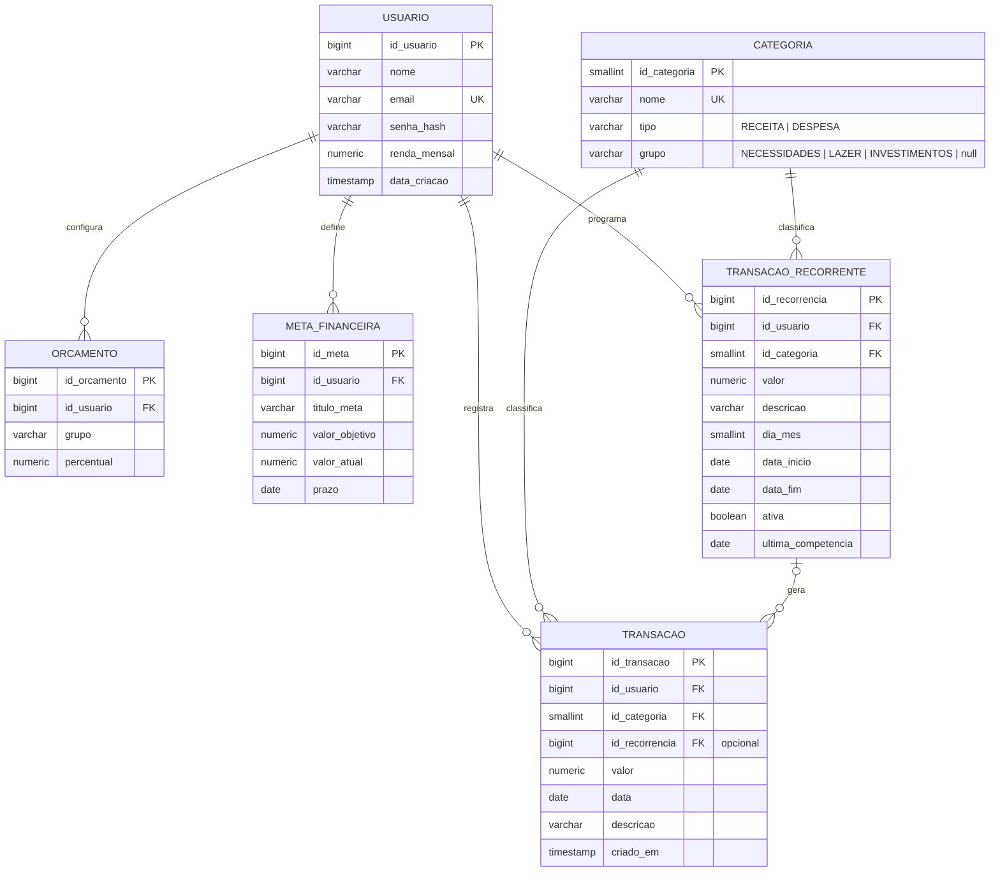

# 04 · Modelo de Dados

## 1. Decisões do modelo

- **Sai:** `conta_carteira` e `investimento` (a calculadora não persiste nada).
- **Categoria é fixa e global** (sem `id_usuario`), carregada por migration. Ela carrega o **tipo** e o **grupo**.
- **Transação não guarda o tipo nem o grupo**: ambos vêm da categoria (evita inconsistência, regra RN02).
- **Orçamento** é a configuração de 3 percentuais por usuário (um por grupo). O limite em R$ é calculado: `renda × percentual`.
- **Recorrência** é um modelo (`transacao_recorrente`) que gera transações comuns; a transação gerada guarda `id_recorrencia` (opcional) e depois vive sozinha.
- Valores monetários: `NUMERIC(12,2)`. Percentuais: `NUMERIC(5,2)`.
- Esquema criado **somente por migrations Flyway**; JPA com `ddl-auto=validate`.

## 2. Diagrama entidade-relacionamento



## 3. Dicionário de dados

### usuario
| Coluna | Tipo | Regras |
|---|---|---|
| id_usuario | BIGSERIAL | PK |
| nome | VARCHAR(100) | obrigatório |
| email | VARCHAR(150) | obrigatório, **único** |
| senha_hash | VARCHAR(100) | hash BCrypt (nunca a senha) |
| renda_mensal | NUMERIC(12,2) | ≥ 0, padrão 0 |
| data_criacao | TIMESTAMP | padrão `now()` |

### categoria (fixa)
| Coluna | Tipo | Regras |
|---|---|---|
| id_categoria | SMALLSERIAL | PK |
| nome | VARCHAR(50) | obrigatório, único |
| tipo | VARCHAR(10) | `RECEITA` ou `DESPESA` |
| grupo | VARCHAR(15) | `NULL` para receita; `NECESSIDADES`, `LAZER` ou `INVESTIMENTOS` para despesa |

### transacao
| Coluna | Tipo | Regras |
|---|---|---|
| id_transacao | BIGSERIAL | PK |
| id_usuario | BIGINT | FK → usuario (CASCADE) |
| id_categoria | SMALLINT | FK → categoria (RESTRICT) |
| id_recorrencia | BIGINT | FK → transacao_recorrente (SET NULL), opcional |
| valor | NUMERIC(12,2) | **> 0** |
| data | DATE | obrigatório |
| descricao | VARCHAR(255) | texto livre (ex.: "pizza", "internet") |
| criado_em | TIMESTAMP | padrão `now()` |

### orcamento
| Coluna | Tipo | Regras |
|---|---|---|
| id_orcamento | BIGSERIAL | PK |
| id_usuario | BIGINT | FK → usuario (CASCADE) |
| grupo | VARCHAR(15) | `NECESSIDADES`, `LAZER`, `INVESTIMENTOS` |
| percentual | NUMERIC(5,2) | entre 0 e 100; **soma por usuário = 100** (validada no service) |
| — | — | `UNIQUE (id_usuario, grupo)` |

### meta_financeira
| Coluna | Tipo | Regras |
|---|---|---|
| id_meta | BIGSERIAL | PK |
| id_usuario | BIGINT | FK → usuario (CASCADE) |
| titulo_meta | VARCHAR(100) | obrigatório |
| valor_objetivo | NUMERIC(12,2) | > 0 |
| valor_atual | NUMERIC(12,2) | ≥ 0, padrão 0 |
| prazo | DATE | opcional |

### transacao_recorrente
| Coluna | Tipo | Regras |
|---|---|---|
| id_recorrencia | BIGSERIAL | PK |
| id_usuario | BIGINT | FK → usuario (CASCADE) |
| id_categoria | SMALLINT | FK → categoria (RESTRICT); precisa ser de tipo DESPESA (validado no service) |
| valor | NUMERIC(12,2) | > 0 |
| descricao | VARCHAR(255) | texto livre (ex.: "internet") |
| dia_mes | SMALLINT | 1 a 31 |
| data_inicio | DATE | obrigatória |
| data_fim | DATE | opcional; ≥ data_inicio |
| ativa | BOOLEAN | padrão `true` |
| ultima_competencia | DATE | 1º dia do último mês já gerado; `NULL` se nunca gerou |

## 4. Migration alvo — `V1__criar_esquema.sql`

```sql
CREATE TABLE usuario (
    id_usuario    BIGSERIAL PRIMARY KEY,
    nome          VARCHAR(100)  NOT NULL,
    email         VARCHAR(150)  NOT NULL UNIQUE,
    senha_hash    VARCHAR(100)  NOT NULL,
    renda_mensal  NUMERIC(12,2) NOT NULL DEFAULT 0 CHECK (renda_mensal >= 0),
    data_criacao  TIMESTAMP     NOT NULL DEFAULT now()
);

CREATE TABLE categoria (
    id_categoria SMALLSERIAL PRIMARY KEY,
    nome         VARCHAR(50) NOT NULL UNIQUE,
    tipo         VARCHAR(10) NOT NULL CHECK (tipo IN ('RECEITA', 'DESPESA')),
    grupo        VARCHAR(15) CHECK (grupo IN ('NECESSIDADES', 'LAZER', 'INVESTIMENTOS')),
    CONSTRAINT ck_categoria_tipo_grupo CHECK (
        (tipo = 'RECEITA' AND grupo IS NULL) OR
        (tipo = 'DESPESA' AND grupo IS NOT NULL)
    )
);

CREATE TABLE transacao_recorrente (
    id_recorrencia     BIGSERIAL PRIMARY KEY,
    id_usuario         BIGINT        NOT NULL REFERENCES usuario(id_usuario) ON DELETE CASCADE,
    id_categoria       SMALLINT      NOT NULL REFERENCES categoria(id_categoria) ON DELETE RESTRICT,
    valor              NUMERIC(12,2) NOT NULL CHECK (valor > 0),
    descricao          VARCHAR(255),
    dia_mes            SMALLINT      NOT NULL CHECK (dia_mes BETWEEN 1 AND 31),
    data_inicio        DATE          NOT NULL,
    data_fim           DATE,
    ativa              BOOLEAN       NOT NULL DEFAULT TRUE,
    ultima_competencia DATE,
    CHECK (data_fim IS NULL OR data_fim >= data_inicio)
);
CREATE INDEX idx_recorrente_usuario ON transacao_recorrente (id_usuario);

CREATE TABLE transacao (
    id_transacao   BIGSERIAL PRIMARY KEY,
    id_usuario     BIGINT        NOT NULL REFERENCES usuario(id_usuario) ON DELETE CASCADE,
    id_categoria   SMALLINT      NOT NULL REFERENCES categoria(id_categoria) ON DELETE RESTRICT,
    id_recorrencia BIGINT        REFERENCES transacao_recorrente(id_recorrencia) ON DELETE SET NULL,
    valor          NUMERIC(12,2) NOT NULL CHECK (valor > 0),
    data         DATE          NOT NULL,
    descricao    VARCHAR(255),
    criado_em    TIMESTAMP     NOT NULL DEFAULT now()
);
CREATE INDEX idx_transacao_usuario_data ON transacao (id_usuario, data);

CREATE TABLE orcamento (
    id_orcamento BIGSERIAL PRIMARY KEY,
    id_usuario   BIGINT       NOT NULL REFERENCES usuario(id_usuario) ON DELETE CASCADE,
    grupo        VARCHAR(15)  NOT NULL CHECK (grupo IN ('NECESSIDADES', 'LAZER', 'INVESTIMENTOS')),
    percentual   NUMERIC(5,2) NOT NULL CHECK (percentual >= 0 AND percentual <= 100),
    UNIQUE (id_usuario, grupo)
);

CREATE TABLE meta_financeira (
    id_meta        BIGSERIAL PRIMARY KEY,
    id_usuario     BIGINT        NOT NULL REFERENCES usuario(id_usuario) ON DELETE CASCADE,
    titulo_meta    VARCHAR(100)  NOT NULL,
    valor_objetivo NUMERIC(12,2) NOT NULL CHECK (valor_objetivo > 0),
    valor_atual    NUMERIC(12,2) NOT NULL DEFAULT 0 CHECK (valor_atual >= 0),
    prazo          DATE
);
CREATE INDEX idx_meta_usuario ON meta_financeira (id_usuario);
```

## 5. Migration de dados — `V2__categorias_fixas.sql`

```sql
INSERT INTO categoria (nome, tipo, grupo) VALUES
  ('Salário',               'RECEITA', NULL),
  ('Freelance',             'RECEITA', NULL),
  ('Rendimentos',           'RECEITA', NULL),
  ('Mesada/Presente',       'RECEITA', NULL),
  ('Reembolso',             'RECEITA', NULL),
  ('Outras receitas',       'RECEITA', NULL),

  ('Moradia',               'DESPESA', 'NECESSIDADES'),
  ('Contas fixas',          'DESPESA', 'NECESSIDADES'),
  ('Alimentação',           'DESPESA', 'NECESSIDADES'),
  ('Transporte',            'DESPESA', 'NECESSIDADES'),
  ('Saúde',                 'DESPESA', 'NECESSIDADES'),
  ('Educação',              'DESPESA', 'NECESSIDADES'),
  ('Parcelas e dívidas',    'DESPESA', 'NECESSIDADES'),

  ('Delivery',              'DESPESA', 'LAZER'),
  ('Passeio',               'DESPESA', 'LAZER'),
  ('Assinaturas',           'DESPESA', 'LAZER'),
  ('Compras e vestuário',   'DESPESA', 'LAZER'),
  ('Viagem',                'DESPESA', 'LAZER'),
  ('Outros (lazer)',        'DESPESA', 'LAZER'),

  ('Renda fixa',            'DESPESA', 'INVESTIMENTOS'),
  ('Renda variável',        'DESPESA', 'INVESTIMENTOS'),
  ('Reserva de emergência', 'DESPESA', 'INVESTIMENTOS'),
  ('Previdência',           'DESPESA', 'INVESTIMENTOS');
```

> Dados de demonstração (usuário João com transações de exemplo) ficam em um script **separado** de desenvolvimento (`dev-seed.sql`), fora das migrations de produção. A senha de demonstração deve ser criada pela própria API de cadastro, para já sair com hash BCrypt.

## 6. Mapeamento JPA (orientação)

| Entidade | Observações |
|---|---|
| `Usuario` | campo `senhaHash`; **nunca** serializar para JSON |
| `Categoria` | `@Enumerated(STRING)` em `tipo` e `grupo`; somente leitura |
| `Transacao` | `@ManyToOne Categoria`; `usuarioId` vem do token; sem campos `tipo`/`grupo` |
| `Orcamento` | enum `GrupoOrcamento`; um registro por (usuário, grupo) |
| `TransacaoRecorrente` | `@ManyToOne Categoria`; `ultimaCompetencia` (`LocalDate`) controla a geração; `ativa` pausa o modelo |
| `MetaFinanceira` | `valorAtual` iniciando em `BigDecimal.ZERO` |

Enums Java: `TipoCategoria {RECEITA, DESPESA}` e `GrupoOrcamento {NECESSIDADES, LAZER, INVESTIMENTOS}`. Os enums antigos `TipoConta`, `TipoJuros` (persistido), `TipoOrcamento` e o `TipoCategoria` com 8 valores da V1 são removidos; `TipoJuros {SIMPLES, COMPOSTO}` continua existindo apenas como parâmetro da calculadora.
