# 05 · Diagramas

Todos os diagramas estão em **Mermaid** (renderizam direto no GitHub e no VS Code com extensão). O usuário de exemplo é **João**. Eles substituem os diagramas da V1 e refletem o escopo da V1 revisada (sem Conta/Carteira, sem persistência de investimento).

## 1. Diagrama de casos de uso

Todos os casos de uso abaixo fazem parte do sistema **IFO**; o único ator é o usuário (João).

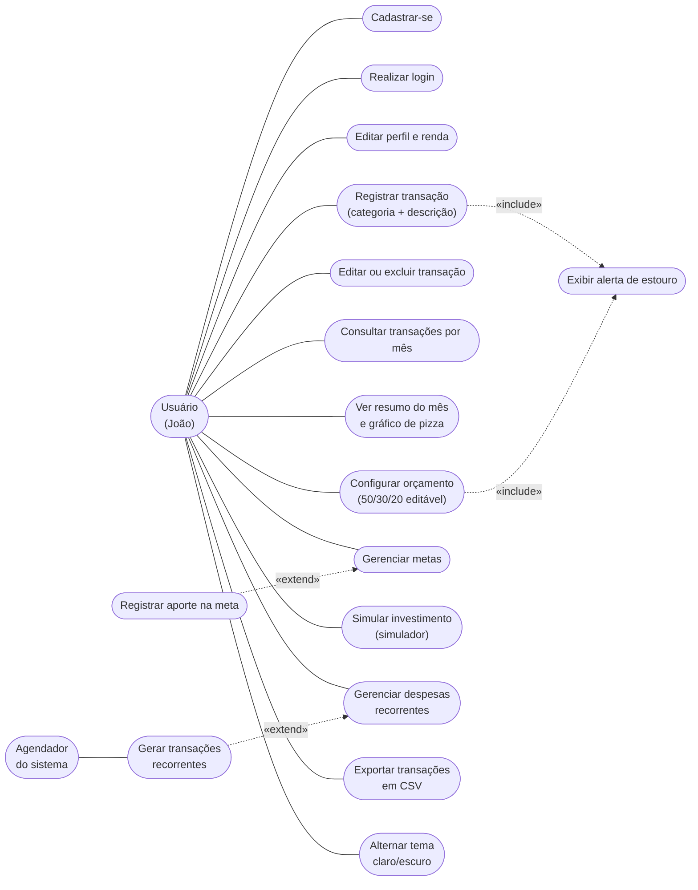

## 2. Diagrama de classes

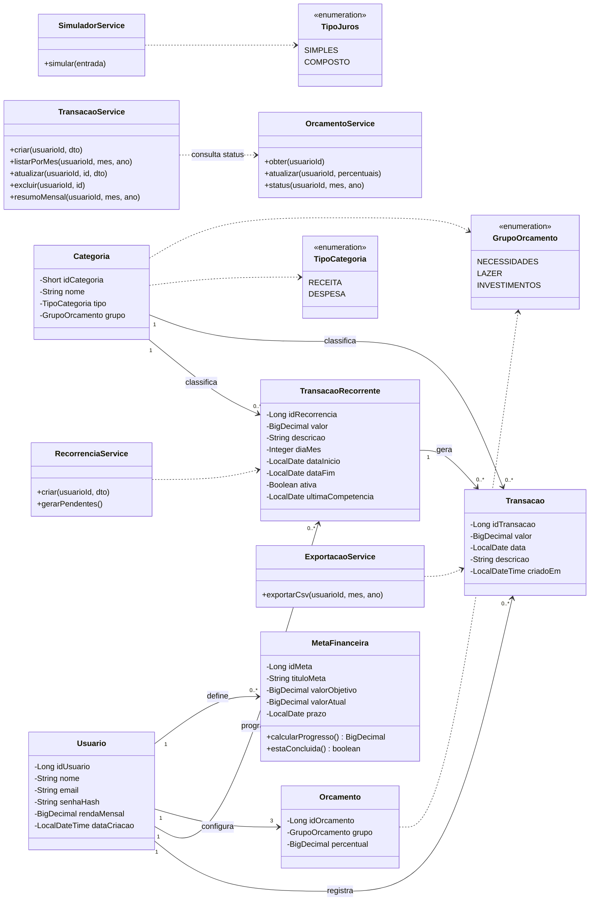

> `ResumoMensal`, `ResultadoSimulacao`, `StatusOrcamento` e `TransacaoResposta` são **DTOs** (não são tabelas). Não existe classe de conta/carteira nem de investimento persistido.

## 3. Diagramas de sequência

### 3.1 Login

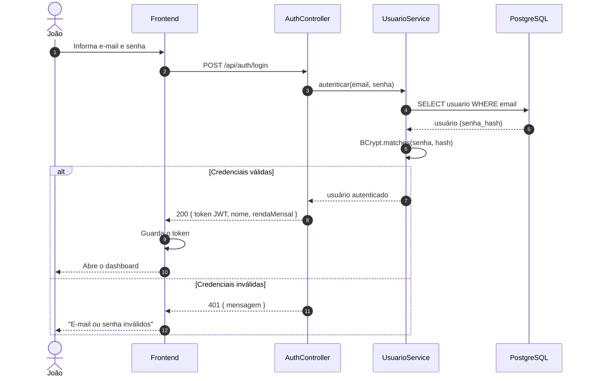

### 3.2 Registrar despesa com alerta de orçamento

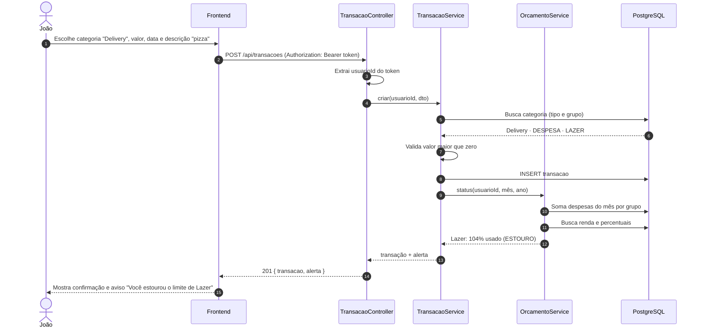

### 3.3 Simular investimento (sem persistência)

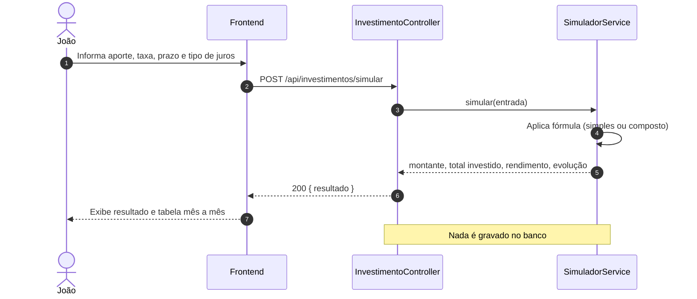

## 4. Diagramas de processo (BPMN simplificado)

Os processos seguem a legenda da V1: **cor** indica quem executa a tarefa. Formas: retângulo = tarefa, losango = decisão, círculo = início/fim, cilindro = banco de dados.

| Cor | Significado |
|---|---|
| Azul | Tarefa do usuário / frontend |
| Verde | Tarefa do backend (processamento) |
| Roxo | Persistência no banco de dados |
| Vermelho | Mensagem de alerta ou erro |
| Amarelo | Decisão (gateway exclusivo) |

### 4.1 Processo 1 — Autenticação e cadastro

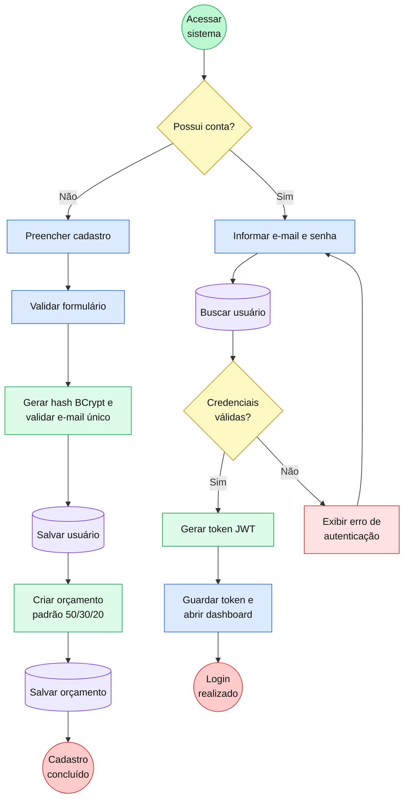

### 4.2 Processo 2 — Registrar transação e alertar estouro

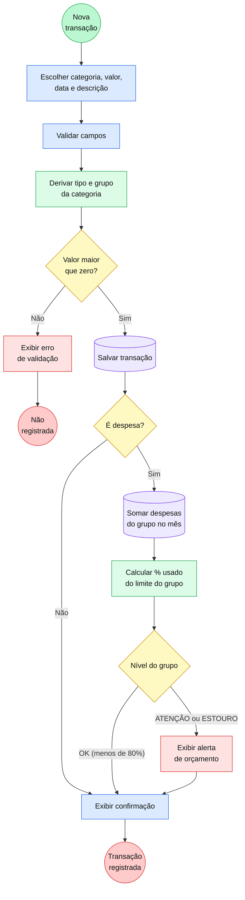

### 4.3 Processo 3 — Configurar orçamento

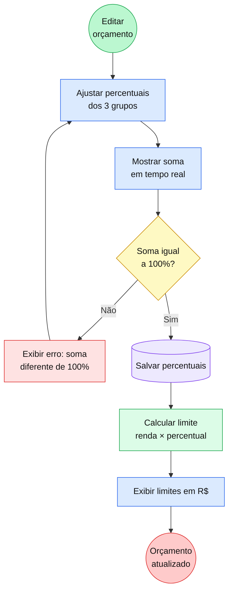

### 4.4 Processo 4 — Metas financeiras

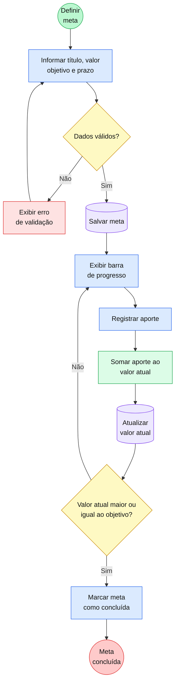

### 4.5 Processo 5 — Simulador de investimentos

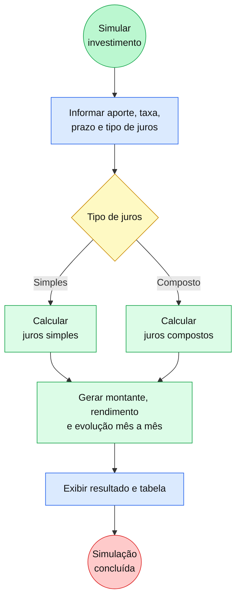

> Observação: a V1 tinha uma etapa "Salvar simulação no BD". Ela foi **removida** (decisão ADR-003).

### 4.6 Processo 6 — Geração automática de despesa recorrente

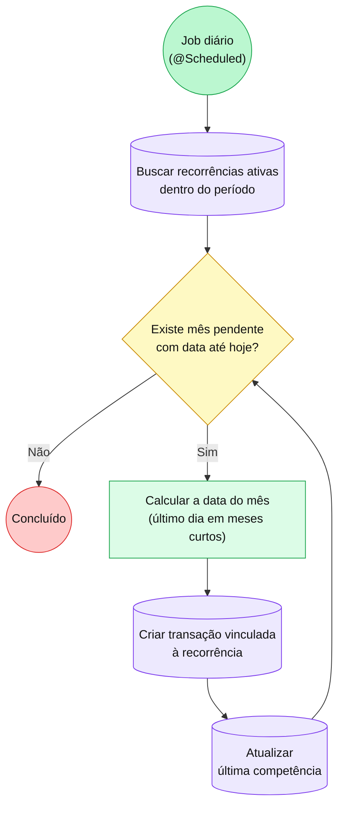

> A geração é **idempotente**: a última competência impede duplicar transações mesmo que o job rode duas vezes ou fique dias parado (RN15).

## 5. Arquitetura em camadas

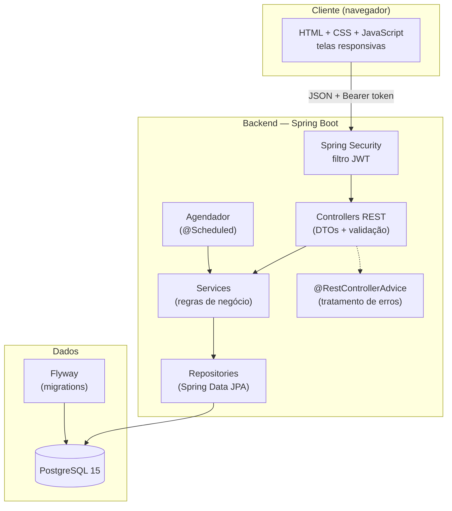
